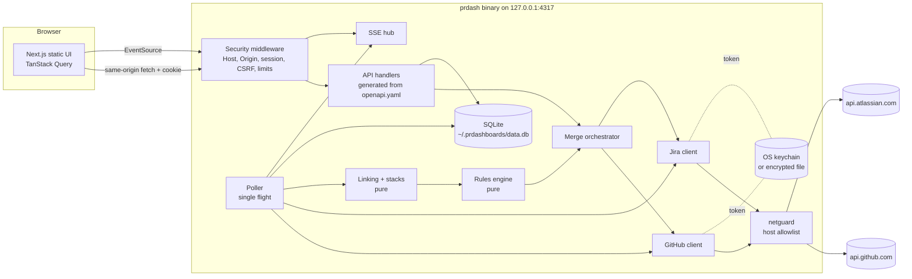
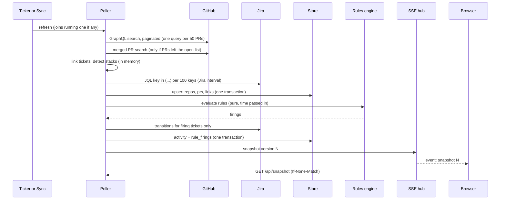
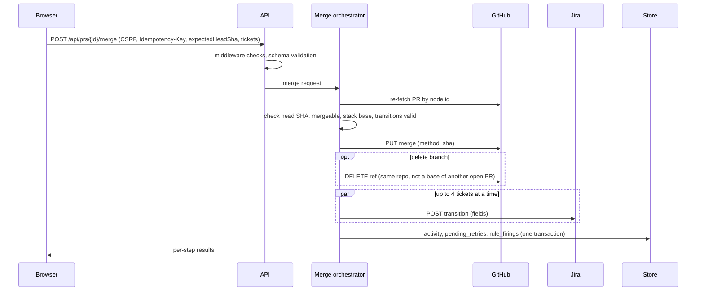

# Architecture

Cross-cutting rules and the feature index. Details of each part live in
[TECH_SPEC.md](TECH_SPEC.md), and each feature gets its own doc in [features/](features/README.md)
when it is built.

## Components

The browser never holds a GitHub or Jira token and never calls either service directly.

## Refresh flow

## Merge flow

## Cross-cutting rules

### Calls and performance

- No N+1 calls. The PR list is one paginated GraphQL search. Tickets are one JQL per 100 keys.
  Transitions are fetched only for the tickets being moved. The only single-PR call is the re-check
  before a merge.
- One refresh at a time. Browser tabs read the snapshot and never trigger outside calls on their
  own.
- At most 4 parallel outbound requests per provider. Back off on `403`, `429` and `503`.
- Stack detection, linking and rule evaluation are O(n) passes with maps, never nested scans over
  all PRs.

### Storage

- One writer (a single-connection pool). Multi-row changes run in one transaction. No per-row loops against the
  database.
- Tokens and client secrets live only in the encrypted vault (its key in the OS keychain) or the passphrase-protected fallback. Never in SQLite,
  logs or API responses.

### Security

- Bind to `127.0.0.1` only. Treat the browser as a remote client: every request passes the
  middleware chain in TECH_SPEC 8.4.
- No CORS. No generic proxy endpoint. The API exposes named operations only.
- Every write re-checks state on the server against fresh data. The client's view is never trusted
  as proof that an action is allowed.
- Outbound calls go only through `netguard`.
- Test fakes exist only in the `e2e` build.

### Package boundaries

- `rules`, `linking`, `stacks` and the merge method resolver are pure: no network, no database, no
  clock. Time is passed in.
- Only `github`, `jira` and `auth` make outbound calls. Only `store` touches SQLite.
- The web app talks only to `/api/*` and `/events` on its own origin.
- `api/openapi.yaml` is the contract. Go and TS types are generated from it and never edited by
  hand.

### Frontend

- Rows subscribe to their own PR, so one change re-renders one row.
- Links are built from validated parts, never taken from API data as is.
- No `dangerouslySetInnerHTML`. No third-party scripts, fonts or CDNs at runtime.

## Feature index

| Feature | Doc | Status |
| --- | --- | --- |
| App shell, launch and session | [features/app-shell.md](features/app-shell.md) | Built |
| Security middleware | [features/security.md](features/security.md) | Built |
| Storage and secrets | [features/storage.md](features/storage.md) | Built |
| GitHub and Jira auth | [features/auth.md](features/auth.md) | Built |
| Poller and snapshot | [features/poller.md](features/poller.md) | Built |
| Command Table | [features/command-table.md](features/command-table.md) | Built |
| Ticket linking | [features/ticket-linking.md](features/ticket-linking.md) | Built |
| Stacked PRs | [features/stacked-prs.md](features/stacked-prs.md) | Built |
| Merge method | [features/merge-method.md](features/merge-method.md) | Built |
| Merge and transition | [features/merge-and-transition.md](features/merge-and-transition.md) | Built |
| Status sync rules and Multi-PR tickets | [features/status-sync-rules.md](features/status-sync-rules.md) | Built |
| Settings drawer | [features/settings.md](features/settings.md) | Built |
| Theme | [features/theme.md](features/theme.md) | Built |
| Installable app (PWA) | [features/installable-app.md](features/installable-app.md) | Built |

Each doc is added, from the template in [features/README.md](features/README.md), in the PR that
builds the feature. Every feature of v1 is built.
